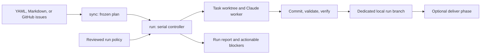

# Roadrunner architecture

Roadrunner has a supervised workflow for local delivery and an interactive Claude hook workflow. The supervised workflow uses frozen plans and its own run records. The interactive workflow uses the current project roadmap and project-level Claude settings.

## Supervised run



- `intake.py` reads a selected backlog, records stable source IDs and revisions, and writes the normalized plan. Issue content contributes task requirements.
- `supervisor.py` starts from committed HEAD, schedules eligible tasks serially, and owns Git and validation. The live worker gets Claude file tools inside a macOS sandbox. Its writable worktree and scratch directory are separate from the operator checkout and controller metadata. Operator-approved gates run without network access.
- A task resolves when its validated candidate is integrated onto the run branch and its evidence is recorded. Pending dependencies, missing inputs, failures, and cancellation have explicit outcomes.
- `delivery.py` prepares a remote delivery plan after checking local evidence. Explicit execution verifies the remote head, required checks, merge tree, and issue source revisions before recording remote outcomes.

Plans, source revisions, and run directories live under `roadrunner/` in the Git common directory. Each run has a frozen policy, `run.json`, logs, attempt records, and integration evidence. The run record gives the path to the temporary task worktrees. Resume reconciles recorded progress under the original deadline and attempt and budget charges.

For platform limits and tested scenarios, see the [qualification checklist](shipping-implementation-checklist.md). For the trust assumptions, see the [security policy](../SECURITY.md).

## 1. Interactive Claude hook loop

Project hooks route Claude lifecycle events to the legacy CLI. The CLI owns task status and Git transitions. Claude implements the scoped changes.

```text
┌────────────────────────── Claude Code Session ──────────────────────────┐
│                                                                         │
│   SessionStart hook          Stop hook            PreCompact hook       │
│   (inject snapshot)          (after each turn)    (write snapshot)      │
│         │                         │                       │             │
│         ▼                         │                       ▼             │
│   CLAUDE.md  ─►  roadrunner next/start/validate/complete   .context_…   │
│                                                                         │
└─────────────────────────────────────────────────────────────────────────┘
```

### 1.1 Per-task control flow

1. Claude reads its brief from `CLAUDE.md`.
2. `roadrunner next` → identifies the eligible task.
3. `roadrunner start TASK-XXX` → creates the task branch, sets `in_progress`, and pins the validation definition.
4. Claude implements the task within the scope declared by `files_expected`.
5. `roadrunner validate TASK-XXX` → runs every `validation_commands` entry. Exit 0 or non-zero.
6. On failure, fix and retry.
7. `roadrunner complete TASK-XXX --notes "…"` → reruns pinned validation, integrates the task, records `done`, and writes the work log.
8. Claude finishes its turn. Stop hook fires.
9. Stop hook calls `roadrunner check-stop` (see §2.1). The hook either lets the session end or injects the next task brief.

### 1.2 State files

| File | Purpose |
|---|---|
| `tasks/tasks.yaml` | Source of truth for task definitions and status. Schema-validated on load, written atomically (tempfile + `fsync` + `os.replace`), 5 rolling `.bak` files. |
| `.roadmap_state.json` | Current task ID, iteration counter, per-task attempt counter. Carries `schema_version` (ADR-009). Reads/writes guarded by an `fcntl.flock` on `.roadmap_state.lock`. |
| `.context_snapshot.json` | Written by PreCompact (§2.3), verified by PostCompact (§2.4). Carries `schema_version`. Provides cold-resume state if a session crashes mid-task; not consumed by SessionStart, which reads `tasks.yaml` live to avoid stale-snapshot poisoning. |
| `logs/CHANGELOG.md` | Append-only audit trail of status changes. Rotated on the task boundary when over 10 MB. |
| `logs/TASK-XXX.md` | Per-task work log with validation output. Authoritative history; not rotated. |
| `logs/trace.jsonl` | Structured per-event JSON trace. Rotated, retained 7 days. |
| `.reset_TASK-XXX` | Boundary marker written on task completion. |

---

## 2. Hook Contracts

### 2.1 Stop (`hooks/stop_hook.sh`)

**Fires:** after every Claude response turn.

**Input (stdin):** Claude Code runtime payload — `stop_hook_active` flag + `last_assistant_message`.

**Output:** exit 0 with a JSON decision or an empty body. A soft block such as `{"decision":"block","reason":"Continue working"}` supplies the next instruction. A hard halt such as `{"continue":false,"stopReason":"Max iterations reached"}` ends the loop.

1. The shell wrapper exits silently if the project is paused.
2. The controller advances the lifetime and session counters and checks budget and iteration limits. An unreadable task queue produces a controlled halt.
3. `stop_hook_active` allows a silent stop when no task is active or eligible. A final standalone `ROADMAP_COMPLETE` signal is accepted when every task is done.
4. Otherwise the controller resumes the active task, auto-blocks work that exhausts its allowance or repeats the same failure, or emits the next task brief. It reports remaining blockers when no task can proceed.

Start, completion, and block serialize task transitions with Stop using the same state lock. Completion releases the lock while validation runs and rechecks the active task before integration.

### 2.2 SessionStart (`hooks/session_start_hook.sh`)

**Fires:** when a Claude Code session begins or resumes (including after compaction restarts).

**Output (stdout):** JSON with `additionalContext` containing a turn-1 directive — resume brief for an in-progress task, "next action" prompt for an eligible todo, blocked-task report, or `ROADMAP_COMPLETE` prompt when all tasks are done.

```json
{
  "hookSpecificOutput": {
    "hookEventName": "SessionStart",
    "additionalContext": "Continue working on TASK-003 …"
  }
}
```

Reads `tasks.yaml` live rather than `.context_snapshot.json` — a stale or missing snapshot must not be able to produce a misleading directive. Resets the per-session iteration counter so the new session's first Stop-hook fire sees `session_iteration=1` (ROAD-010). Always exits 0 — informational, never blocks. Delegates to `roadrunner session-start`.

### 2.3 PreCompact (`hooks/precompact_hook.sh`)

**Fires:** before Claude Code compacts the conversation.

**Side effect:** writes `.context_snapshot.json` so a crashed or interrupted session has cold-resume state on disk. PostCompact (§2.4) verifies it survived; SessionStart deliberately does not consume it (§2.2).

**`.context_snapshot.json` schema (v1):**

```json
{
  "schema_version": 1,
  "snapshot_at": "2026-04-15T09:00:00Z",
  "current_task": "TASK-003",
  "iteration": 7,
  "next_eligible": "TASK-004",
  "status_summary": {"TASK-001": "done", "TASK-002": "done", "TASK-003": "done", "TASK-004": "todo"}
}
```

PreCompact does not support `additionalContext` — restoration after compaction relies on Claude Code's own conversation continuity, not the snapshot.

### 2.4 PostCompact (`hooks/postcompact_hook.sh`)

**Fires:** after Claude Code completes context compaction.

**Side effect:** verifies `.context_snapshot.json` survived and emits a `post_compact_verify` event to `logs/trace.jsonl`. PostCompact does not support decision control, so this hook is purely observational and always exits 0. Delegates to `roadrunner post-compact`.

### 2.5 PostToolUse (`hooks/post_write_hook.sh`)

**Fires:** when Claude uses Write or Edit. Matcher: `"Write|Edit"`.

**Behavior:** lint feedback to Claude on the next turn. `.py` files → `ruff check`; `.yaml`/`.yml` → safe-load validation (path passed via `argv`, never interpolated). Non-blocking.

### 2.6 PreToolUse (`hooks/protect_roadmap_hook.sh`)

**Fires:** before Claude uses Write or Edit. Matcher: `"Write|Edit"`.

**Behavior:** exits 2 when the tool targets this project's `tasks/tasks.yaml`, so Claude Code blocks the operation before writing. Status updates use `roadrunner start`, `roadrunner complete`, or `roadrunner block`. The hook is registered in the project settings shipped by `roadrunner init`.

---

## 3. Hook workflow trust boundary

`tasks.yaml` is **executable configuration**. The `validation_commands` list is run via `subprocess.run(cmd, shell=True)` — every command runs with the operator's full privileges. This is by design for a single-operator tool: the operator authors the tasks, the operator trusts the commands.

- Treat `tasks.yaml` like a Makefile or CI pipeline. A `rm -rf /` entry will execute.
- Validation commands are subject to a configurable timeout (default 300s; per-task `validation_timeout`) so a hanging command cannot block the loop indefinitely (ADR-008).
- Task IDs are validated against `^[A-Z]+-\d+$` on every load to prevent path traversal in derived filenames (`logs/{task_id}.md`, `.reset_{task_id}`, git branch names).
- Roadrunner assumes the person writing `tasks.yaml` is the person running it. No access control, no sandboxing, no approval flow. Appropriate for local development and overnight runs on a single machine; not appropriate for shared infrastructure.

---

## 4. Architecture Decision Records

| ADR | Title |
|---|---|
| [001](adr/001-line-anchored-completion-signal.md) | Line-Anchored Completion Signal |
| [002](adr/002-check-stop-in-progress-awareness.md) | Check-Stop In-Progress Awareness |
| [003](adr/003-retry-storm-prevention.md) | Per-Task Attempt Counter and Auto-Block |
| [004](adr/004-atomic-writes-and-data-integrity.md) | Atomic File Writes for State Integrity |
| [005](adr/005-absolute-hook-paths.md) | Absolute Hook Paths via `$CLAUDE_PROJECT_DIR` |
| [006](adr/006-structured-trace-logging.md) | Structured JSON Trace Logging |
| [007](adr/007-dead-hook-cleanup.md) | Dead Hook Cleanup |
| [008](adr/008-validation-timeout-and-task-id-sanitization.md) | Validation Timeout and Task ID Sanitization |
| [009](adr/009-state-schema-versioning-and-concurrency-lock.md) | State Schema Versioning and Concurrency Lock |
| [010](adr/010-hook-python-entrypoint-unification.md) | Hook → Python Entry Point Unification |
| [011](adr/011-roadmap-vs-hotfix-commit-convention.md) | Roadmap vs Hotfix Commit Convention |

The append-only [`hotfix-log.md`](hotfix-log.md) records observation-driven fixes that didn't warrant an ADR. Frozen historical reviews live in [`history/`](history/).
